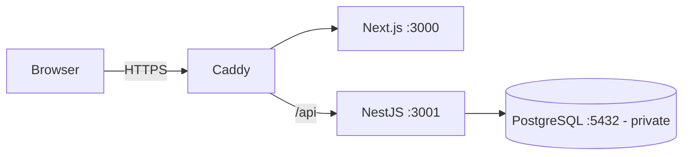
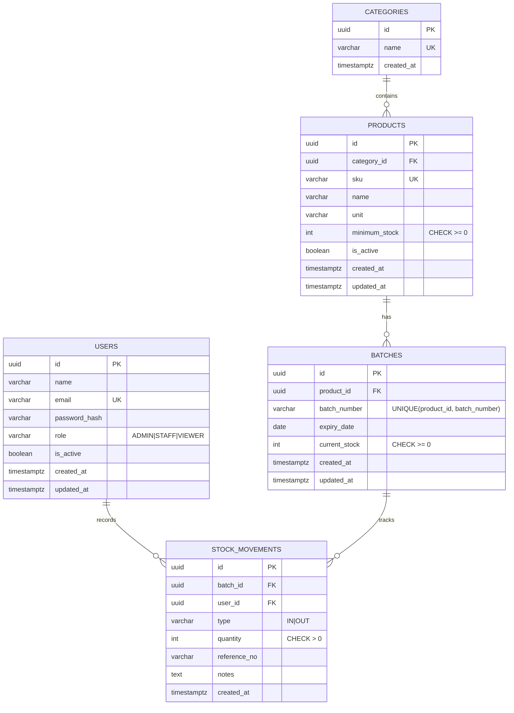

# PharmaStock — Blueprint v1.0

> Dokumen ini dikunci sebagai v1.0. Fitur baru (supplier, PO, multi-warehouse) **tidak** ditambahkan sebelum MVP selesai & online.

## 1. Definisi

Aplikasi web untuk mengelola stok produk farmasi berdasarkan nomor batch, tanggal kedaluwarsa, dan riwayat pergerakan stok.

| Role   | Kewenangan                                         |
| ------ | -------------------------------------------------- |
| ADMIN  | Kelola produk, batch, stok, pengguna               |
| STAFF  | Lihat data, buat batch, catat stok masuk/keluar    |
| VIEWER | Hanya melihat (dipakai untuk akun demo publik)     |

## 2. Arsitektur

Modular monolith (1 aplikasi NestJS).



## 3. ERD



Aturan penting:
- `current_stock` (saldo) dan `stock_movements` (riwayat) **selalu** diubah dalam satu database transaction dengan row lock (`SELECT ... FOR UPDATE`).
- Riwayat stok tidak bisa diubah/dihapus via API.
- Produk dinonaktifkan (`is_active=false`), bukan dihapus.
- FEFO: sistem merekomendasikan batch yang paling cepat expired (belum expired).

## 4. REST API (`/api/v1`)

| Method | Endpoint             | Role         |
| ------ | -------------------- | ------------ |
| POST   | /auth/login          | Public       |
| GET    | /auth/me             | Login        |
| GET    | /users               | Admin        |
| POST   | /users               | Admin        |
| PATCH  | /users/:id           | Admin        |
| GET    | /categories          | Login        |
| POST   | /categories          | Admin        |
| GET    | /products            | Login        |
| GET    | /products/:id        | Login        |
| POST   | /products            | Admin        |
| PATCH  | /products/:id        | Admin        |
| GET    | /batches             | Login        |
| POST   | /batches             | Admin/Staff  |
| GET    | /batches/expiring    | Login        |
| POST   | /stock/in            | Admin/Staff  |
| POST   | /stock/out           | Admin/Staff  |
| GET    | /stock/movements     | Login        |
| GET    | /dashboard/summary   | Login        |
| GET    | /health              | Public       |

Format response seragam lewat Global Response Interceptor & Global Exception Filter:

```json
{ "success": true, "statusCode": 201, "message": "...", "data": {} }
{ "success": false, "statusCode": 409, "message": "Insufficient stock", "errors": null }
```

## 5. Keamanan (wajib sejak awal)

| Komponen        | Implementasi                                                  |
| --------------- | ------------------------------------------------------------- |
| Authentication  | JWT, bcrypt                                                   |
| Authorization   | JwtAuthGuard + RolesGuard                                     |
| Validation      | DTO + global ValidationPipe (`whitelist`, `forbidNonWhitelisted`), body size limit |
| Rate limiting   | @nestjs/throttler, lebih ketat di /auth/login                 |
| Database        | Postgres tidak diekspos ke internet, user DB terbatas         |
| HTTPS           | Caddy (TLS otomatis)                                          |
| Secrets         | `.env` tidak di-commit, divalidasi saat startup               |
| Swagger         | Publik dibaca, operasi tulis butuh token                      |
| Demo mode       | Data fiktif, akun Viewer read-only, tidak ada Admin publik    |
| Token di browser| Cookie HttpOnly + Secure + SameSite, bukan localStorage       |
| TypeORM         | `synchronize: false`, pakai migrations                        |
| Monitoring      | Health check, Docker logs, CPU/RAM                            |
| Backup          | pg_dump terjadwal + uji restore                               |
| Audit           | Setiap stock movement mencatat user & waktu                   |

## 6. Testing Wajib

| Kasus                                   | Hasil                 |
| --------------------------------------- | --------------------- |
| Password salah                          | 401                   |
| Tanpa token                             | 401                   |
| Viewer POST produk                      | 403                   |
| SKU duplikat                            | 409                   |
| Stock out > stok                        | 409                   |
| Stock out batch expired                 | Ditolak               |
| Quantity <= 0                           | 400                   |
| Field tidak dikenal                     | 400                   |
| Dua stock out bersamaan                 | Stok tidak negatif    |
| Transaksi gagal                         | Tidak ada perubahan parsial |

## 7. Roadmap

1. **Foundation** — monorepo, PostgreSQL, TypeORM, 5 entity + migration, Swagger
2. **Core Backend** — Categories, Products, Batches, DTO, pagination
3. **Business Logic** — Stock In/Out, transaction & locking, JWT & roles, testing
4. **Frontend** — Login, dashboard, products, batches, stock
5. **Security & Deployment** — rate limit, cookies, Docker Compose, VPS, HTTPS, backup
6. **Portfolio** — README, ERD, screenshot, live demo, review
